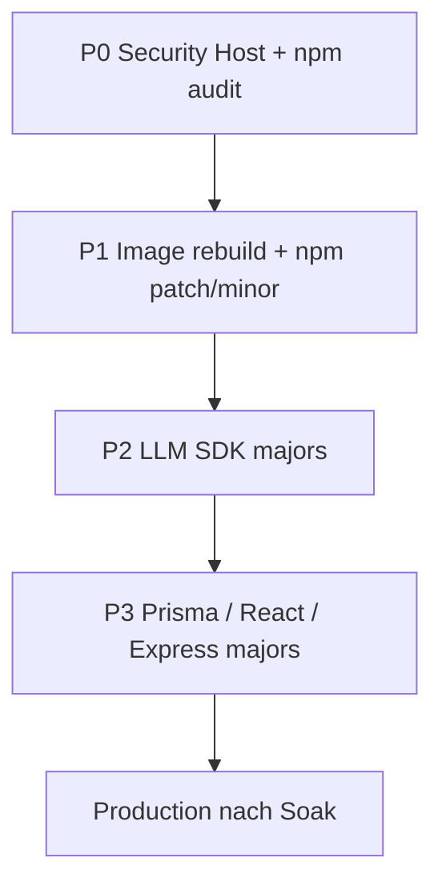

# Software-Stack-Updates: Priorisierung, Tests, Rollback, Staging

**Version:** 1.0  
**Datum:** 2026-11-07 (Europe/Vienna)  
**Kontext:** Meaningful Conversations / manualmode — v2.6.0, Staging & Production Build 72  
**Referenzen:** `SYSTEM-CONFIG.md`, `memory-bank/techContext.md`, `deploy-manualmode.sh`, `scripts/check-updates.sh`, `scripts/MONITORING-QUICK-REFERENCE.md`, Skill `llm-upgrade` (classic/practice regression)

---

## 1. Ziel und Grundsätze

| Grundsatz | Umsetzung |
|-----------|-----------|
| Staging vor Production | Jede Stack-Änderung zuerst auf mc-beta.manualmode.at |
| Eine Welle pro Schicht | Nicht OS-Reboot + Prisma-Major + LLM-SDK in einem Deploy mischen |
| Build once, deploy everywhere | Images in Registry; Production pullt Staging-Tags (`deploy-manualmode.sh`) |
| Messbare Go/No-Go-Kriterien | CI grün + definierte Smoke-/Regression-Checks |
| Rollback vor Debug-Marathon | Bei Deploy-Fehler automatisches Rollback nutzen, dann Ursache in Ruhe fixen |

**Standing rule (Staging-DB):** Kein Staging-Login, keine E2EE-Maintenance und kein DB-Reset ohne explizite Freigabe — siehe `memory-bank/activeContext.md`.

---

## 2. Stack-Inventar und typisch offene Updates

### 2.1 Schicht A — Host (AlmaLinux 9.8, Podman)

| Komponente | Ist (letzter bekannter Stand) | Offen / wiederkehrend |
|------------|------------------------------|------------------------|
| Kernel / OpenSSH / Podman | Security-Patch 2026-11-04, Kernel `5.14.0-687.65.1` | Wöchentlich: `scripts/check-updates.sh` (Mo ~07:15 Europe/Vienna) |
| Routine-Updates (nicht nur Security) | Nach Security-Lauf oft „keine kritischen“ | `dnf check-update` — Moderate/Low gebündelt planen |
| Reboot | Nach Kernel-Update | `needs-restarting` / Ops-Report live Kernel vs installiert |

### 2.2 Schicht B — Container-Basis & Infrastruktur-Images

| Komponente | Ist | Offen |
|------------|-----|-------|
| Node-Runtime in App-Images | `node:22-bookworm` / `-slim` | Digest-Refresh (Debian-Pakete in Image) |
| MariaDB | `mariadb:11.2` (Compose) | Minor/LTS-Sprünge innerhalb 11.x prüfen (Staging zuerst) |
| TTS (Piper) | Eigenes Image | Nur bei `tts-service/`-Änderungen oder Base-Image-Refresh |
| Nginx (Host) | Reverse Proxy | Certbot/Lets Encrypt — unabhängig von App-Deploy |

### 2.3 Schicht C — npm (Anwendung)

**Patch/Minor (niedriges Risiko, gebündelt):** u. a. `helmet`, `express-rate-limit`, `axios`, `marked`, `@capacitor/*` Patches innerhalb ^8.x, `pm2` Patch.

**Major / breaking (eigene Wellen, nicht bündeln):**

| Paket | Ist (package.json) | Latest (npm registry, repo-Scan) | Risiko |
|-------|-------------------|----------------------------------|--------|
| `@google/genai` | ^2.x | 3.x | API-Verhalten, Classic/Practice-Regression |
| `@mistralai/mistralai` | ^2.x | 3.x | Wie oben + Mistral-Overlay |
| `@prisma/client` / `prisma` | ^5.22 | 7.x | Schema/Migrate, Query-Engine |
| `react` / `react-dom` | ^18.2 | 19.x | Gesamtes Frontend + Jest |
| `express` | ^4.22 | 5.x | Routing/Middleware — **später** |
| `@revenuecat/purchases-capacitor` | ^13.x | 14.x | iOS IAP + ASC-Test |
| `@apple/app-store-server-library` | ^1.6 | 3.x | JWS/Notifications |
| `framer-motion` | ^12.x | 14.x | Nur mit React-Welle oder getrennt testen |

**Bereits erledigt / niedrige Priorität:** `npm audit` Frontend/Backend 0 vulns (Stand `progress.md`); PM2-Advisory als akzeptiertes Risiko (`systemPatterns.md` §8).

### 2.4 Schicht D — Mobile (Capacitor / Xcode)

- Capacitor 8.x: Patch-Upgrades mit `npm ci` + `npx cap sync ios` + `verify-ios-plugin-packages.mjs`
- RevenueCat / Apple SDK-Majors: Sandbox-IAP auf Staging-Backend (`sync:ios-staging`, `verify:ios-iap`)
- App Store 2.6.0-Submit unabhängig von Server-Stack, aber gleiche Versionsdisziplin (`BUILD_NUMBER`)

---

## 3. Priorisierung (P0–P3)



| Prio | Was | Trigger | Zieltermin |
|------|-----|---------|------------|
| **P0** | AlmaLinux Security (`dnf updateinfo --security`), kritische Kernel/OpenSSH/Podman | Ops-Mail, `check-updates.log`, Critical/Important ALSA | Nächstes Wartungsfenster nach Backup (Mo 06:00 Backup, siehe Cron-Übersicht) |
| **P0** | Neue `npm audit` high/critical | CI oder manuell | Sofort PR, Staging, dann Prod |
| **P1** | `node:22-bookworm` Rebuild + npm Patch/Minor (eine PR) | Monatlich oder vor Prod-Release | Staging-Deploy, 24h Soak |
| **P1** | MariaDB 11.2 → nächstes 11.x Patch | Release Notes / CVE | Staging-Pod nur MariaDB-Container recreaten + Migrations-Check |
| **P2** | `@google/genai` / `@mistralai` Major | Geplant, Skill `llm-upgrade` | Staging + classic/practice regression |
| **P2** | `@apple/app-store-server-library` | Vor ASC/IAP-Änderungen | Staging IAP-Webhook-Tests |
| **P3** | Prisma 7 | Eigenes Projekt (Migrate-Diff, Staging-DB-Klon) | Kein Parallel zu P2 |
| **P3** | React 19 | Eigenes Projekt | Kein Parallel zu Prisma |
| **Defer** | Express 5 | Kein Release-Druck | Erst nach React/Node-Ökosystem stabil |

**Nicht in diesem Stack-Plan:** Feature-Roadmap (PayPal Subscriptions, Android, SLM) — siehe `memory-bank/progress.md`.

---

## 4. Teststrategie

### 4.1 Immer (jede Welle)

| Stufe | Befehl / Aktion | Gate |
|-------|-----------------|------|
| Lokal/CI | `npm run ci` (Frontend + Backend Jest, typecheck, locales, build) | Muss grün sein |
| PR | GitHub Actions `.github/workflows/test.yml` | Grün vor Merge |

### 4.2 Nach App-/npm-Änderungen (Staging)

| Bereich | Test |
|---------|------|
| Health | `https://mc-beta.manualmode.at/api/health` → `status: ok` |
| Auth | Login Registered (nur mit Freigabe auf Staging-DB), Token-Refresh |
| Classic Coaching | Kurzsession, Ende, Session Review |
| Connector / PDF | Optional je nach Diff |
| Admin | Health nicht rate-limited; Admin-Panel lädt |
| TTS | Eine DE/EN-Ausgabe (Piper-Container) |
| Deploy-Skript | Frontend + Backend HTTP-Checks + public health nach Nginx-Update |

### 4.3 LLM-SDK-Upgrades (P2) — zusätzlich

Folge Skill **`llm-upgrade`** (Projekt-Doku):

1. `npm run classic-regression -- baseline` / `compare-offline` (oder Staging-`compare` nur bewusst live)
2. `npm run practice-regression --` analog
3. Safety-Szenarien in Baselines (`utils/classicRegressionBaselines/`)
4. Staging: beide Provider (Google + Mistral) je 1 Kurzchat, `aiProviderService` Hot-Reload aus DB

**Go/No-Go P2:** Keine Regression unter Schwellwert (Skill), keine neuen 5xx in Backend-Logs, Ops-Report Staging OK.

### 4.4 Host-Updates (P0)

| Schritt | Verifikation |
|---------|----------------|
| Vor Reboot | Ops-Report, beide Backups `production-*.sql.gz` / `staging-*.sql.gz` OK |
| Nach Reboot | `mc-podman-compose-boot.service`, `podman ps`, `update-nginx-ips.sh` beide Envs |
| Health | Prod + Staging `/api/health` 200 |
| Watchdog | `mc-stack-watchdog` — kein dauerhaft unhealthy Backend |

### 4.5 iOS-relevante npm-Wellen

- `npm run sync:ios-staging`
- `npm run verify:ios-iap` / `verify:ios-plugin-packages.mjs`
- Physisches Gerät: Paywall/Restore nur mit abgestimmtem Review-Account (nicht `premium@manualmode.at` für Kauf-Demo)

---

## 5. Rollback-Strategie

### 5.1 App-Deploy (Frontend/Backend/TTS-Tag)

**Automatisch:** `deploy-manualmode.sh` speichert `.previous-version` auf dem Server, prüft Container-Health + öffentliche `/api/health`, rollt bei Fehler Registry-Images der Vorversion zurück und führt `update-nginx-ips.sh` aus.

**Manuell (wenn Auto-Rollback nicht greift):**

```bash
# Vom Dev-Rechner (SERVER_HOST in .env.server)
./deploy-manualmode.sh -e staging -s -p -v <PREV_VERSION>
# oder Production: -e production (pull-only)
```

**Voraussetzungen:** Vorversion noch in Registry (`podman-image-cleanup.sh` behält laufende + 2 neueste Tags).

### 5.2 Git / npm

- Ein Update-Welle = ein Commit (oder ein PR); Rollback = `git revert` + erneuter Staging-Deploy
- Lockfile: `package-lock.json` ist Source of Truth; in Dockerfiles weiterhin versionsgebunden (Hinweis Cross-Platform `npm install` in Docker — siehe Dockerfiles)

### 5.3 MariaDB-Image / Migration

- **Vor** Prisma-Migrate auf Staging: manuelles Dump (`mariadb-dump`) oder tägliches Backup nutzen
- **Rollback:** Compose-Image auf `11.2` zurück, Volume unverändert lassen; bei kaputter Migration Restore aus `staging-YYYYMMDD-*.sql.gz` (nur mit User-Freigabe)

### 5.4 Host (dnf / Kernel)

- Paket-Rollback: `dnf history` / `dnf downgrade` einzelner Pakete (selten)
- Kernel: vorheriger Eintrag in GRUB nach fehlgeschlagenem Boot
- **Zeitfenster:** Reboot Mo früh nach Backup, Ops-Report Mo 07:30/07:45 beobachten

### 5.5 Eskalation

| Symptom | Erste Aktion |
|---------|----------------|
| 502 / unhealthy Backend | `mc-stack-watchdog` Log; ggf. `make`-Targets / `repair_backend` (siehe MONITORING-QUICK-REFERENCE) |
| Rollback schlägt fehl | Alte Version manuell pull + compose up; Nginx IPs |
| DB inkonsistent | Kein improvisiertes E2EE-Rewrap — Restore aus Backup |

---

## 6. Durchführung auf Staging (Playbook)

### Phase 0 — Vorbereitung (15–30 Min.)

1. Ops-Report / `check-updates.log` lesen (was ist wirklich offen?)
2. Welle wählen (nur P0, oder P1-PR, …)
3. Branch `cursor/stack-update-<welle>-482a` vom aktuellen `main`
4. Bei DB-Risiko: Notiz Backup-Alter Staging

### Phase 1 — Änderung & lokale Gates

1. Änderungen + `npm run ci`
2. Bei LLM: Regression offline
3. Commit, Push, PR — CI grün

### Phase 2 — Staging-Deploy

```bash
./deploy-manualmode.sh -e staging          # oder -c backend / frontend
# Optional nur Backend:
./deploy-manualmode.sh -e staging -c backend
```

4. SSH: `podman ps`, Backend-Logs Tail
5. Public health + manueller Smoke (Abschnitt 4.2)
6. Bei LLM: Staging-Regression live

### Phase 3 — Soak

| Welle | Empfohlene Soak-Zeit |
|-------|----------------------|
| P0 Host-Reboot | Bis Ops-Report + 1 voller Tag ohne Alert |
| P1 Patch/minor | 24 h |
| P2 LLM SDK | 48 h + erneute Regression |
| P3 Major (Prisma/React) | 72 h + gezielte QA-Liste |

Staging darf während Soak weiter genutzt werden; **keine** riskanten DB-Skripte.

### Phase 4 — Production

1. `./deploy-manualmode.sh -e production` (kein Rebuild — pull Staging-Tag)
2. Gleiche Smoke wie 4.2 auf mc-app.manualmode.at
3. `server-ops-report.sh` am Folgetag prüfen

**Cron-Kollision vermeiden:** Montag Prod-Pull laut Doku ~08:30 Europe/Vienna — nicht parallel zu Backup 06:00; Security-Reboot nicht unmittelbar vor geplantem Prod-Pull ohne Abstimmung.

---

## 7. Wellen-Roadmap (Vorschlag)

| Welle | Inhalt | Abhängigkeiten |
|-------|--------|----------------|
| **W1** | P0 Security-Host (falls Ops meldet) + ggf. npm audit Fix | Keine |
| **W2** | P1: npm Patch/Minor-Bundle + Docker-Rebuild (Digest) | W1 stabil |
| **W3** | P2: `@google/genai` + `@mistralai` (ein PR oder zwei sequenziell) | W2, Skill llm-upgrade |
| **W4** | P2: Apple Server Library + ggf. RevenueCat minor | IAP-Tests |
| **W5** | P3: Prisma 7 (Staging-Migrate, lange Soak) | W3 abgeschlossen |
| **W6** | P3: React 19 + ggf. framer-motion | W5 oder parallel nur Frontend-Branch |
| **—** | Express 5 | Backlog |

Jede Welle: kurzer Eintrag in `memory-bank/activeContext.md` (Datum, Version, Ergebnis).

---

## 8. Checkliste Staging Go-Live (Kurz)

- [ ] CI grün
- [ ] Deploy ohne Rollback
- [ ] `/api/health` Staging 200
- [ ] Nginx IPs aktualisiert (im Deploy-Skript)
- [ ] Smoke Classic Session OK
- [ ] Bei LLM: Regression Go
- [ ] Ops-Report nächster Lauf: Staging + Backup Staging OK
- [ ] Freigabe für Production dokumentiert

---

## 9. Offene Punkte zur Abstimmung

1. **Soak-Dauer Production:** 24 h vs. 48 h nach LLM-Major?
2. **MariaDB-Sprung:** Nur Patch innerhalb 11.2 vs. Upgrade auf neuestes 11.x LTS?
3. **React 19:** Vor oder nach iOS 2.6.0 ASC-Release?
4. **Wartungsfenster Host-Reboot:** Feste Mo 07:00–08:00 Europe/Vienna?

---

**Maintainer:** Projekt-Owner + Agent nach Freigabe pro Welle.
